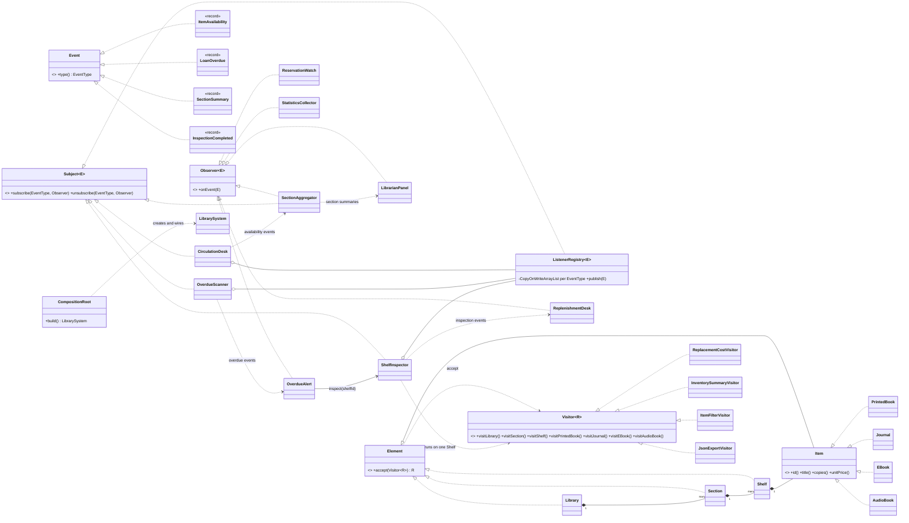

# LibraryHub - Observer + Visitor (Assignment 6, variant 18: Library)

Small Java 17 system for a library. A live data source notifies subscribers (**Observer**),
and new operations are added to a stable catalog tree (**Visitor**). Only JUnit 5 is used, no other libraries.

## Build, test, run

```bash
mvn test                                   # 42 JUnit 5 tests
mvn -q compile
java -cp target/classes libraryhub.Main --threads=4 --pairs=500
```

`--threads` is the number of producer threads (ExecutorService size, default 3), `--pairs` is how
many check-out + return pairs each producer performs (2 events per pair).

## Architecture



## Observer side

| Subject (source) | Event records | Listeners |
| --- | --- | --- |
| `CirculationDesk` | `ItemAvailability` (ITEM_CHECKED_OUT, ITEM_RETURNED) | `ReservationWatch` (one per waiting member, added at runtime), `SectionAggregator`, `StatisticsCollector` |
| `OverdueScanner` | `LoanOverdue` | `OverdueAlert`, `LibrarianPanel`, `StatisticsCollector` |
| `ShelfInspector` | `InspectionCompleted` | `ReplenishmentDesk`, `LibrarianPanel`, `StatisticsCollector` |
| `SectionAggregator` (listener **and** subject) | `SectionSummary` | `LibrarianPanel`, `StatisticsCollector` |

Own generic interfaces: `Subject<E extends Event>`, `Observer<E extends Event>`; events are immutable records
with an `EventType`; listeners subscribe per event type. No `java.util.Observable`, no event-bus library.

**Chain of observers.** `CirculationDesk -> SectionAggregator -> LibrarianPanel`. The aggregator listens to
availability events and republishes per-section totals as `SectionSummary`.

**Push, not pull.** Every event carries all data a listener needs (item, section, shelf, member, copies left).
Reasons: (1) listeners never call back into the source, so there is no extra coupling and no deadlock risk;
(2) the event is an immutable snapshot, so with several producer threads a listener cannot see a state that
changed between the notification and its read (pull would race with the next check-out); (3) one event instance
is shared by all listeners without copying. Cost: events have a few more fields.

**Thread-safe registry without locking the subject.** `ListenerRegistry` keeps one `CopyOnWriteArrayList` per
event type in a map that is built once in the constructor and never changed. Publishing iterates a snapshot,
so a listener can unsubscribe itself (`ReservationWatch` does exactly that) or others from inside its handler,
and other threads can subscribe/unsubscribe while events are published. Subscriptions made during a publish
start with the next event. A listener that throws does not stop the others; the error goes to an injected handler.
Delivery is synchronous in the producer's thread, so no event can be lost in a queue; the cost is that a slow
listener slows its producer.

## Visitor side

Tree: `Library -> Section -> Shelf -> Item` (3 container types, 4 leaf types: `PrintedBook`, `Journal`,
`EBook`, `AudioBook`). Elements are records: data only plus the one-line `accept`.

| Visitor | Kind | Result |
| --- | --- | --- |
| `ReplacementCostVisitor` | numeric calculation | `Double` (price + shipping per physical copy, e-books without shipping) |
| `InventorySummaryVisitor` | accumulates state across the tree | `InventorySummary` (titles, copies, copies per kind) |
| `ItemFilterVisitor` | filter | `List<Item>` matching a predicate, in tree order |
| `JsonExportVisitor` | hand-written export | JSON `String`, correctly nested, with escaping |

**Double dispatch.** `visitor.visit(node)` cannot work for a `List<Element>` because Java chooses the overload
from the static type (`Element`), and no `visit(Element)` exists. `node.accept(visitor)` first dispatches on the
runtime class of the node (virtual call), and that class calls the matching `visitX(this)` where `this` has
its exact type, which is the second dispatch.

**Who traverses: the visitor.** Containers only call `visitor.visitShelf(this)`; the visitor decides how to walk
the children. Reason: operations differ in order and in what they do with child results (sum, merge lists, build
nested JSON strings, count into a field). With a traversal inside the tree every visitor would have to fit
one fixed walk (e.g. enter/leave callbacks for JSON). Cost: each visitor repeats the loop over children in its three
container methods (one stream expression each).

**Stateful visitor.** `InventorySummaryVisitor` keeps counters in fields, so one instance is used per traversal;
`ShelfInspector` creates fresh visitors for every inspection, so concurrent inspections share nothing.

**Stock is not in the tree.** The tree is immutable and thread-safe by construction. Copies currently on the
shelf live in `Inventory` (atomic counters bounded by `[0, total]`), and visitors that need stock (low-stock filter)
get it by injection.

## Integration

`OverdueScanner` publishes `LoanOverdue` -> `OverdueAlert` calls `ShelfInspector.inspect(shelfId)` -> the inspector
runs three visitors **on that one `Shelf` subtree only** (not the whole library) -> publishes `InspectionCompleted`
-> `ReplenishmentDesk` opens a `ReplenishmentTicket` for low-stock items and `LibrarianPanel` logs the result.
(alert -> inspection -> ticket.)

## Concurrency (Clean Code ch. 13)

* `ProducerPool` wraps `Executors.newFixedThreadPool(n)` (n is configurable). `CirculationProducer` threads
  borrow and return items concurrently.
* Shared state: `ListenerRegistry` (copy-on-write), `Inventory` (CAS loop on `AtomicInteger`), `LoanLedger`
  (`ConcurrentHashMap`), `StatisticsCollector` (`LongAdder`), `SectionAggregator` (`ConcurrentHashMap.compute`,
  each update atomic), `LibrarianPanel` (`merge` keeps the summary with the most updates, so out-of-order delivery
  cannot leave a stale summary). Nothing locks a whole subject.
* Graceful shutdown: `shutdown()` stops new tasks but lets submitted ones finish, `awaitTermination(timeout)`,
  then `shutdownNow()` plus an exception if producers hang. Failures inside producers are rethrown, not swallowed.
  Events are delivered synchronously, so when the pool is done, every event has been delivered.

## Clean Code (ch. 11-12)

* One composition root: `CompositionRoot.build(...)` creates and wires every object and all subscriptions;
  everything else receives dependencies through constructors.
* No lazy initialization in business code: maps and counters are created in constructors (the registry map is
  pre-filled for all event types and then read-only).
* No duplication: leaf visit methods delegate to one private helper; element validation is in `Checks`.
* Every interface has a reason: `Event`/`Observer`/`Subject` (generic observer), `Element`/`Item`/`Visitor` (tree).

<!--TRADEOFF-->

## Tests

42 tests: registry behaviour (typed delivery, duplicate subscription, unsubscribe inside the handler,
subscribe during publish, failing listener), catalog index and validation, all four visitors against
hand-calculated values (documented in `TestCatalogs`), exact JSON nesting and escaping, circulation and overdue scan,
the observer chain, runtime reservations, the integration flow (subtree only, ticket), a **stress test with 4 threads x 1,000 events
and exact expected counts**, subscribe/unsubscribe churn during publishing, atomic inventory, graceful shutdown,
hanging and failing producers.
